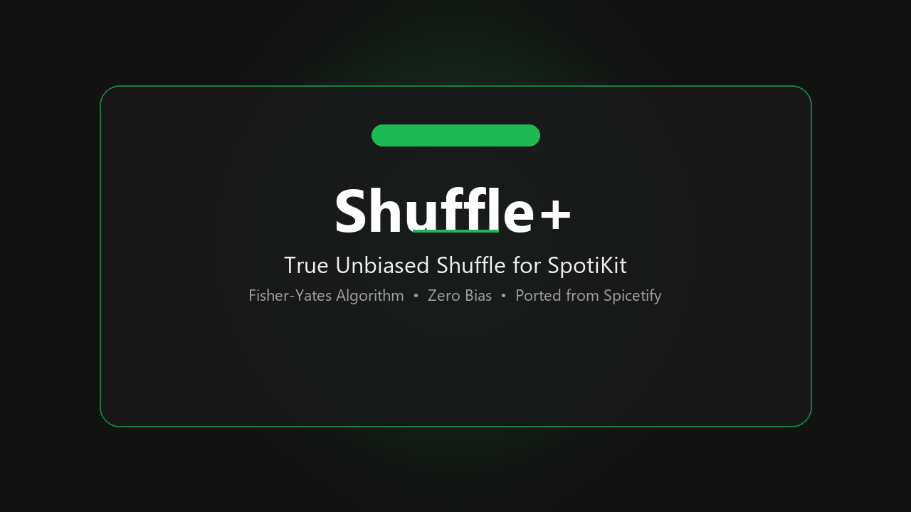

# Shuffle+ — True Unbiased Shuffle Extension for SpotiKit

Eliminate Spotify's weighted shuffle bias on **Spotify for Windows**. **Shuffle+** is a native [**SpotiKit**](https://spotikit.com) port of Spicetify's [`shuffle+.js`](https://github.com/spicetify/cli/blob/main/Extensions/shuffle%2B.js) from [`spicetify/cli`](https://github.com/spicetify/cli) using a true Fisher-Yates shuffle algorithm.

## Features
- **True Randomness:** Uses an unbiased Fisher-Yates algorithm instead of Spotify's weighted shuffle
- **Shuffle Everything:** Right-click any playlist, folder, album, artist, Liked Songs, or track selection to **Shuffle+**
- **Customizable Settings:** Configure queue behavior, artist/album grouping, and auto-play options via the native dialog
- **Hot-Reloadable:** Toggles on and off instantly without restarting Spotify

## Install

1. **One-Click Install:** [**Open in SpotiKit Marketplace**](https://spotikit.com/install/wazixinho/shuffle-plus) *(or search **Shuffle+** under **Marketplace → Extensions** inside Spotify)*.
2. **Install from Link:** Click the link icon at the top of the SpotiKit Marketplace and paste `https://github.com/wazixinho/shuffle-plus` *(or URI: `spotify:app:marketplace:install:wazixinho:shuffle-plus`)*.

## Credits & Original Repository
- **Original Spicetify Extension:** [`shuffle+.js`](https://github.com/spicetify/cli/blob/main/Extensions/shuffle%2B.js) in [`spicetify/cli`](https://github.com/spicetify/cli) by `khanhas` and [`Tetrax-10`](https://github.com/Tetrax-10)
- **SpotiKit Port:** [@wazixinho](https://github.com/wazixinho)
